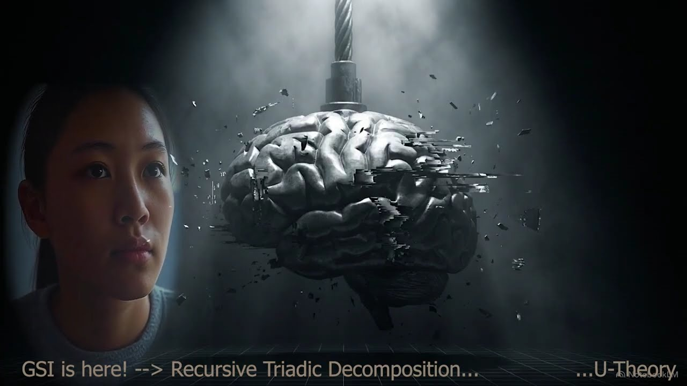

# APPENDIX HOG — THE HAND OF GOD

## Jev as the typed decision hand of the Lady Galaxy Protocol

[](https://youtu.be/ApdvPB2hEgA)

📺 **Video: The Grammar of Existence is U = ∛(F · P · A) — The Hand of GOD!** (U-Model) · [Watch on YouTube](https://youtu.be/ApdvPB2hEgA)

> *"The hand may decide. Only the record can say whether it was right."*

| | |
|---|---|
| **Author** | Petar Nikolov |
| **Date** | 2026-10-10 |
| **Framework** | U-Theory / U-Model · UMSG |
| **Status** | Specification with measured components. Extends `APPENDIX_LGP` v.27 without changing it |
| **Version** | 1.1 (v1.0 frozen as `THE HAND OF GOD v1.0.md`) |
| **Epistemic Level** | **L1 — operational.** Every number is marked *measured* (on a running system), *synthetic* (simulation, not Jev data) or *specified* (a design rule of this appendix). The review record in HOG.13 is L0. Nothing here is L3 or L4. No accuracy claim about Jev on this workflow can be made: no outcome has been recorded yet (HOG.6.1) |
| **Prerequisites** | `APPENDIX_LGP` v.27 (the 12 steps and the Σ formulas), `APPENDIX_TAA` (the agents F, P, A, Σ), `APPENDIX_JSR` (the noise of a single judge) |
| **Function** | Defines how a typed probabilistic judge is attached to LGP: where it is called, what it is asked, how its answers are read, when its probabilities may be corrected, and where it must not be used |
| **Invariant** | What can be computed is never asked. What is asked is typed, logged and subordinate to measurement. No answer is permission to act |
| **Companion code** | `hog_calibration_reference.py` (HOG.6). The Jev review packets of HOG.13 are kept by the author and not published |
| **Time stamps** | Every Jev opinion and every release of this appendix carries an OpenTimestamps proof (HOG.7.5); the proofs of this appendix are in `time stamps/` |
| **Copyright** | © 2026 Petar Nikolov, CC BY 4.0 · code MIT |

---

## HOG.0 — Why this appendix exists, and what it was made from

`APPENDIX_LGP` gives the procedure: twelve steps, four agents (Form, Position,
Action and the generalising Σ), and the arithmetic of U, δ and SI. It does not
say what a *judgment* is, mechanically. Who answers "which pillar is weakest",
in what form the answer comes back, and how anyone checks it later are all left
to the agent who runs the protocol. Untyped agent judgment is exactly where
confirmation bias, easy agreement and unfalsifiable recommendations enter.

`APPENDIX_SSS` specifies a jury of models and `APPENDIX_JSR` measured what a
jury of one costs. Its open falsifier, JSR-4, has not been run because there
was no second judge from a different model family.

**Jev** is a model of TypeSafe AI, released in limited early access on
15 September 2026. It does not generate text. It takes a state and typed
questions, and returns typed answers with probabilities. Since 20 September 2026
it has been used in this project as an independent typed reviewer, and since
23 September as the judgment layer of LGP, through an implementation called
**LGP+**. The canonical rules of that use are the Jev protocol
(`JEV_PROTOCOL.md`, sections 5 and 15–17) and the Jev system description.

The raw material for this appendix was a conversation with a general-purpose
chat assistant about the public post *"The Hand of GOD!"*. The assistant
proposed an "improved LGP-12R", discussed the calibration of Jev's Choice
answers, and supplied isotonic regression code. This appendix keeps what
survives checking, corrects what does not, and drops what cannot be verified.
Every disposition is listed in HOG.9.

**On the name.** The title is the public name of the work. Technically, the
"hand" is the layer that turns a protocol into acts of judgment: one typed
decision at a time, each logged, each checkable later against what happened. A
hand that cannot be checked is not trusted with anything. This hand decides
nothing irreversible (HOG.11).

---

## HOG.0.1 — An invitation to the great visionaries


*Illustration by the author. It does not imply any endorsement or participation
by the persons shown.*

I address the builders who already think in products, not in sums, and I ask
them to bet on this to change the world for the better.

### To Elon Musk: the hand

> Elon Musk provided his formula for a robot's utility. This is not a metaphor;
> it is an equation.
>
> The utility of a humanoid equals the quality of the AI software multiplied by
> the quality of the AI chip, multiplied by electromechanical dexterity,
> especially that of the hands.
>
> The three factors are not added together; they are multiplied. If any one of
> them is close to zero, the entire robot's utility is close to zero. A brilliant
> brain in clumsy hands, for instance, remains clumsy. A perfect hand without a
> brain is merely an expensive doll. A powerful chip without software is just a
> piece of warm metal.

**Source note.** In his own words (*Cheeky Pint*, 5 February 2026, interviewed
by Dwarkesh Patel and John Collison):

- "Humanoid robots will improve by basically three things that are growing
  exponentially multiplied by each other recursively. You're going to have
  exponential increase in digital intelligence, exponential increase in the AI
  chip capability, and exponential increase in the electromechanical dexterity."
- "From an electromechanical standpoint, the hand is more difficult than
  everything else combined."

The utility equation above is the author's formalisation of those statements.

This is the structure of U = ∛(F · P · A): a product, not a sum. The cube root
is a monotone rescaling that keeps U on the scale of its factors; it does not
change which system ranks higher. In Musk's product the hand is the factor that
is hardest to raise from near zero. In this appendix the hand is the typed
judgment that turns a protocol into acts, one checkable decision at a time.

### To Jack Ma: the language

Alibaba Cloud, part of the group Jack Ma co-founded, describes UModel as
follows:

> UModel (Universal Observability Model) is a graph-based data modeling method
> for observable data. It addresses the core challenges of data collection,
> organization, and usage in enterprise environments. UModel uses a graph
> structure of Nodes and Links to describe the IT world, enabling unified
> representation, storage decoupling, and intelligent analysis of observable
> data. As the data modeling foundation for the Alibaba Cloud observability
> system, UModel provides businesses with a universal "interactive language" for
> observability that allows people, programs, and AI to understand and analyze
> observable data to build true full-stack observability.
>
> — Alibaba Cloud, CloudMonitor 2.0 documentation,
> https://www.alibabacloud.com/help/en/cms/cloudmonitor-2-0/overview/

Observability tells you what a system is and how it is connected. U-Model asks
the next question: will it hold? It answers by Form, Position and Action, and
says which pillar to fix first. The convergence of the two names and structures
is documented in `ARTICLE_U_THEORY_PRIOR_ART_ALIBABA_UMODEL`.

### The bet

The aim is a safe world with fewer surprises, in which how every organisation
behaves is knowable, predictable, assessed and stable. Every organisation would
be measured by the same 45 criteria, judged by typed and logged hands, and
checked against what actually happens. The hand is cheap: 3,132 typed judgments
cost $0.24 (HOG.7.1). What it needs is scale, partners and recorded outcomes.

Bet on it, and test it. Every claim in this appendix carries its falsifier
(HOG.10).

---

## HOG.1 — The instrument: what Jev is, and what it is not

| Property | Value | Source |
|---|---|---|
| Output | Typed answers with probabilities; no generated text | TypeSafe, launch post 2026-09-15 |
| Question types | **Choice** (one of a fixed set of options), **Noul** (probability that a statement holds), **Score** (probability-weighted position on an ordered scale) | TypeSafe documentation |
| Price | $0.042 per million input tokens; output not billed | TypeSafe documentation, models page, checked 2026-09-23 |
| Model used here | `jev-1.13.0`, pinned; the resolved model is recorded on every call | Jev protocol §8, journal |
| Latency | about 1 s per call (historical figure, not a service level) | Jev protocol §1 |
| Packet limits in this bridge | 200,000 characters of state; 32 questions; 60 s timeout | bridge status, 2026-10-10 |

The vendor's own guidance is that System One models "are trained for calibrated
decisions" and that their performance must be validated "in the target domain".
It also says that Choice and Score confidence "summarizes distribution
concentration, not overall workflow correctness or permission to act". This
appendix adopts both statements and adds nothing to them (HOG.6).

**What Jev is not.** It is not a source of facts, not a calculator, not a
writer, not an executor and not an authority. It knows nothing outside the
packet it is given.

> **HOG-1 (Principle of the packet).** *Jev translates the evidence it is given
> into typed numbers. The quality of an answer is the quality of the packet.*
> (Jev protocol §1)

> **HOG-2 (Hierarchy of truth).** *Primary record > deterministic measurement >
> replay > Jev opinion.* When Jev contradicts a measurement, the measurement
> wins and the contradiction is reported. (Jev protocol §5)

A Jev probability is not a p-value, a confidence interval, a power calculation,
a causal effect or a proof of edge.

---

## HOG.2 — Division of labour: hand, arithmetic, owner

### HOG.2.1 Where the hand is called

The canonical placement is the Jev protocol §16.6, implemented in `jev_lgp.py`.
The rule behind it is simple: **a step that can be computed is computed; a step
that needs judgment gets a typed, logged question; a step that needs authority
goes to the owner.**

| LGP step | Who | Jev call | Status |
|---|---|---|---|
| LGP-1 Scan, LGP-2 Detect | main agent: system boundary, problems per pillar, with primary evidence | none (these are facts) | implemented |
| LGP-3 Decompose | F, P, A | **three orthogonal calls**, one per pillar, each with only its own facts | implemented |
| LGP-4 Impact, LGP-5 Leverage | Σ | none (arithmetic) | implemented |
| LGP-6 Synthesis | F, P, A | `best_measure` inside the same three calls; costs T/S/E supplied by the agent | implemented |
| LGP-7 Selection | Σ | η and the exact package are computed; an optional Jev package call runs as a second opinion | implemented |
| LGP-8/9 Plan and resources | agent, owner | none (E-gate: cost, feasibility, authority, legal gates) | implemented |
| LGP-10 Pulse | agent | re-run **only** the pillar whose facts changed; all three after a regression | specified, not scheduled |
| LGP-11 Milestones | agent | none without a new question | implemented |
| LGP-12 Audit | agent | `lgp-audit`: before/after per pillar, prediction error, PEC; outcomes closed against each pillar's `call_id` | implemented |

### HOG.2.2 What each pillar call asks

| Question | Type | LGP step |
|---|---|---|
| `health`: the pillar's sustainability | Score on 5 **anchored** levels tied to the LGP bands (<0.20, 0.20–0.38, 0.38–0.618, 0.618–0.80, >0.80); U_X is the expectation over Jev's probabilities | LGP-1/3 |
| `after__<measure>`: the pillar after each candidate measure of **every** pillar | Score, same anchors | LGP-4/6, D.3 |
| `after__placebo`: the pillar if nothing changes | Score, control arm | — |
| `evidence_sufficient` + mirror | Noul pair | No Evidence → No Claim (LGP C.10.2) |
| `main_problem` (+ `none_material`) | Choice | LGP-2/3 |
| `best_measure` (+ `wait_measure`) | Choice | LGP-6 |

### HOG.2.3 Rules the hand may not break

1. **Σ is computed, never asked.** U, δ, SI, I_instab, leverage, ΔU and η are
   arithmetic in the tool (formulas below).
2. **One fact, one pillar.** A repeated fact id, identical text, or two shared
   distinctive numbers in two pillars is refused (the *numeric fingerprint*).
   Three pillars fed from one source are one confirmation looked at three times.
3. **The E-gate is a veto, not a fourth pillar.** Cost, feasibility, authority
   and legal gates are checked deterministically before U.
4. **Measured beats asked.** A pillar with a deterministic measure carries
   `measured_u`; Σ uses it instead of Jev's estimate and reports both.
5. **A measured zero is a zero.** A pillar measured at 0 gives U = 0, without a
   positive floor (Jev protocol §17.4). The ε-clip of `APPENDIX_LGP` E.12
   (ε = 0.01) may be used only to *rank* collapsed states against each other. It
   never turns a measured collapse into a non-zero U in a report. This settles
   the apparent conflict between E.12 and LGP+.
6. **No answer is permission.** Execution passes through the E-gate and the
   owner.

```text
U_triad  = ∛(U_F · U_P · U_A)
δ        = (max − min) / (max + 0.01)
SI       = U_triad / (1 + δ)²           > 0.618 stable · 0.38–0.618 at risk · < 0.38 critical
d_X      = max(0, θ − U_X)              θ = 0.618 by default
∂U/∂U_X  = U_triad / (3 · U_X)          the weakest pillar has the steepest gain
E[ΔU_X]  = U_triad · (∛(θ / U_X) − 1)   gain from raising pillar X to θ
η        = E[ΔU_X] / C_w,   C_w = α·T + β·S + γ·E   (costs in [0,1], α = β = γ = ⅓)
```

### HOG.2.4 What the source proposed, and why it is not adopted

The source conversation proposed "Jev as the default decision surface at every
ranking, selection, trigger, and confidence gate". That would place an opinion
that moves by 0.10 to 0.20 between identical calls (HOG.4) where a computable
quantity already exists. It would also turn a reviewer into a gatekeeper. It is
not adopted.

A Jev panel was run on this choice (HOG.13, panel B):

- The claim *"the canonical placement is better supported than Jev everywhere"*
  came back **SUPPORTED**: median 0.81, mirror 0.16, agreement 6 of 6 angles.
- The option "everywhere" received a median probability of 0.03.

The same panel left one question open. Adding a Noul with its mirror at LGP-2
(*is this a true instability source?*) and at LGP-10 (*re-enter analysis?*),
where no deterministic trigger exists, scored 0.51 against 0.42 for the plain
canonical placement. That result is **DEPENDS ON THE ANGLE**: hiding the
mechanism flips it. The addition therefore stays a proposal (**HOG-P2**) with
its own falsifier (HOG.10, F2). It is not a rule.

---

## HOG.2.5 — The forbidden act: how the hand is kept from it

[](https://youtu.be/gmr4DnZ5Nh4)

📺 **Video: The Math of the Forbidden Act** (U-Model) · [Watch on YouTube](https://youtu.be/gmr4DnZ5Nh4)

`APPENDIX_POS` names the failure mode. The **Forbidden Action** is a decisive,
hard-to-reverse commitment taken before Form and Position are ready to carry
it: *"Unprepared + irreversible + not an emergency = the Forbidden Action"*
(POS §2.5). POS also separates two meanings of *forbidden* (POS §7):

- **Readiness-forbidden.** Not yet, because the base is not built.
- **Values-forbidden.** Never, because ethics, law or a safety constraint bars it.

A judgment layer that makes decisions cheap and fast would make the forbidden
act cheap and fast too, unless it is locked. This appendix keeps the hand behind
four locks. The first three are enforced in the LGP+ code today. The fourth is
specified here.

### Lock 1 — The hand has no switch (enforced)

The bridge returns typed answers and nothing else. It has no path to submit,
pay, sign, restart or deploy (Jev protocol §9). Every authorisation stays
deterministic and stays with the owner.

> **HOG-6 (Asymmetry of the hand).** *A judgment may add a stop. It may never
> remove one.*

Jev's answers can move a measure from admissible to inadmissible: insufficient
evidence, predicted harm to a pillar, or P(helps) below 0.60. They can never
make a blocked measure admissible. The E-gate (`gate: ok | owner | blocked`) is
set by the agent and the owner before any call, and no Jev output writes to it.

### Lock 2 — The arithmetic refuses compensation, and a veto closes its one gap (enforced)

Take a system that destroys its strongest pillar to gain elsewhere:

| State | F | P | A | Arithmetic mean | U = ∛(F·P·A) | δ | SI |
|---|---:|---:|---:|---:|---:|---:|---:|
| Before | 0.9 | 0.3 | 0.3 | 0.500 | 0.433 | 0.659 | 0.157 |
| Form destroyed, P and A raised | 0.0 | 0.5 | 1.0 | 0.500 | **0.000** | 0.990 | 0.000 |
| Form cut down to the others | 0.3 | 0.3 | 0.3 | 0.300 | 0.300 | 0.000 | **0.300** |

- **The second row** is the forbidden act as a sum sees it: no loss at all
  (0.500 → 0.500). The product sees a collapse. At the zero limit
  non-compensation is exact. In the interior the geometric mean allows a partial
  trade-off, so there the gate is a normative constraint, not a theorem (POS §3).
- **The third row** is the one place where the arithmetic fails. Cutting the
  strongest pillar down lowers δ, so SI nearly doubles (0.157 → 0.300) while U
  falls (0.433 → 0.300). An optimiser of SI would choose to destroy.
- **LGP+ forbids it.** Any measure that lowers any pillar by more than 0.05 is
  inadmissible, whatever SI shows (the conflict veto). A measured zero stays
  zero (HOG.2.3, rule 5).

### Lock 3 — Deterministic exclusions before any package (enforced, `jev_lgp.py`)

A measure never enters a package if:

- the E-gate blocks it;
- its pillar fails the evidence gate (No Evidence → No Claim);
- it is predicted to lower another pillar by more than 0.05;
- it does not raise U;
- or P(helps) is below 0.60.

The package rules add more:

- A prerequisite with any of these faults kills the whole chain that needs it.
- An exclusive group admits one member at a time, for example one live change
  at a time.
- A measure of unknown cost cannot pass a budget.
- Measures gated `owner` are listed for the owner's approval.
- If nothing helps, the package is empty. Doing nothing is a valid answer.

The offline LGP+ test seeds a measure that harms another pillar. It checks that
the measure is ineligible and absent from the chosen package.

### Lock 4 — The POS gate between selection and commitment (specified, proposal HOG-P3)

LGP+ selects; it does not authorise. POS places its commitment gate between
LGP-7 (selection) and LGP-8/9 (plan and resources). This appendix specifies how
the hand feeds that gate:

```text
authorize(a) = [Firewall(a) = PASS] · [ κ(a) ≤ κ_probe
                                       ∨ R(a,t) ≥ 1
                                       ∨ (a = a^emg ∧ M_emg > 0 ∧ log complete) ]

R(a,t) = min( LCB(F|a) / θ_F(a,d,s) ,  LCB(P|a) / θ_P(a,d,s) )      (POS §2.6)
```

- **Readiness is read at the lower bound.** With Jev's pillar values, LCB is the
  10th percentile of the LGP+ Monte Carlo band (or the lowest panel angle), never
  the expectation. This is exactly the use the vendor allows for score
  expectations: checking a threshold, not computing a magnitude (HOG.3).
- **The irreversibility κ(a) is set by the agent and the owner before any call.**
  A Jev opinion may raise κ; it may never lower it (HOG-6).
- **The values firewall comes first and is deterministic.** It is a deny-list of
  objectives checked before LGP+ runs: initiation of force, deception, harm to
  third parties, illegal acts, and the corpus's dual-use classes
  (`APPENDIX_TRC_L4` §L4.5, `APPENDIX_TSE` §9.7). A Jev Noul with its mirror
  (*"this measure initiates force or harms a third party"*) may add a block. It
  can never clear one. In the 45 criteria the same prohibition is written as a
  score: "No Anger, No Initiation of Force, Loyalty" (CODE).
- **The emergency branch belongs to the owner.** `a^emg` needs POS's robust
  margin and a complete log. No Jev answer can declare an emergency.

### The dual-use warning

A map of weakest pillars is a target finder with the sign flipped
(`APPENDIX_TRC_L4` §L4.5). For the hand this means:

- **The sign of the objective is fixed.** Only measures that raise the assessed
  system's own U and harm none of its pillars are admissible; Lock 3 enforces
  this.
- **Third-party weakness maps are never published as target lists.** The
  rankings publish scores and criteria, never "cheapest flip" queues.
- **Private analyses and private data never enter a public artifact.**

These controls are necessary, not sufficient. The tool scores only the system it
is given, so harm to others is caught by the criteria and the deny-list, not by
the arithmetic. Whether the commitment gate pays at all is POS's own open test
(POS-P1, POS-P2), and this appendix does not run it.

---

## HOG.3 — LGP+: what the hand adds to LGP v.27

`APPENDIX_LGP` says *what* to assess and *how* to compute Σ. It leaves open
where the pillar values, the benefit of each measure and their uncertainty come
from. LGP+ closes those gaps. The full list of 17 extensions is in the Jev
protocol §17. The load-bearing ones are:

| Gap in LGP v.27 | LGP+ answer |
|---|---|
| U_X "is measured", with no method | 5 anchored levels per pillar; U_X is the expectation over Jev's probabilities; `measured_u` takes precedence |
| Benefit(r) = U_after − U_before, with no method | **effect matrix**: every pillar scores itself after every candidate measure of every pillar, so side effects (D.3) are estimated rather than assumed |
| the "if something is done" frame is optimistic | **placebo arm** (`after__placebo`); effects are measured against it |
| classification of facts rests on the agent | **blind audit**: Jev assigns each fact to exactly one pillar without seeing where it was filed; `misfiled` and `decomposition_required` flags |
| one evidence gate | **two gates**: Jev (sufficiency + mirror) and a deterministic quality index Q = source × n (live or code 1.0 · replay 0.7 · judgment 0.5 · Jev 0.2); the worse one decides |
| point numbers | **Monte Carlo** from Jev's probabilities: P(weakest pillar), SI band, P(measure helps); "weakest" is declared only at P ≥ 0.60 |
| LGP-7 by η ranking | **exact D.1 solution** by enumeration: maximum SI, at most one measure per pillar, budget, `exclusive` groups, `requires` chains |
| SI can rise while a strong pillar is destroyed | **conflict veto**: any measure that lowers a pillar by more than 0.05 is inadmissible |
| benefits add up | **conservative combination**: the largest benefit counts in full, each further one at half |
| one package choice | computed package and Jev's package side by side; a disagreement goes to the owner with its reason |
| LGP-12 audit by hand | **`lgp-audit`** |

**Honest limits (Jev protocol §17.1).** All Jev numbers are opinions until
outcomes are recorded. The effect matrix has a halo: measures "help a little
with everything". The blind audit classifies partly by content. The Monte Carlo
bands are conservative.

**A limit the protocol does not yet state.** The vendor's page of known weak
points for `jev-1.13` (reviewed 2026-10-02) says that "score levels are weak in
numerical calibration". It asks users not to use score expectations "to compute
the exact magnitude of a number", while allowing the expectation to be used "to
check if it passes a particular threshold". LGP+ computes U_X as exactly such
an expectation and then does arithmetic on it. A Σ built on Jev's U_X is
therefore *band-grade*: it says which LGP band a pillar is in, not its exact
magnitude. This is one more reason why `measured_u` wins, why SI is reported as
a Monte Carlo band, and why the claim stays open in HOG.10 (F9).

---

## HOG.4 — Reading the hand: noise, thresholds, panels

### HOG.4.1 Measured noise

One frozen packet was run three times with the order of facts and options
shuffled (probe, 2026-09-23, *measured*):

| Answer | Largest spread across the three runs |
|---|---:|
| Noul claim | 0.10 |
| Noul mirror | 0.02–0.04 |
| Score (risk) | 0.07 |
| Choice, probability of the leading option | **0.20** |
| Choice, the chosen option itself | stable 3 of 3 |

Three observations give only a rough estimate. A range of 0.20 corresponds to
σ ≈ 0.085 for one call and σ ≈ 0.12 for the difference between two calls.
These are local defaults from one packet. A packet-specific probe overrides
them.

### HOG.4.2 Mechanical reading (Jev protocol §5)

| Answer | Reading |
|---|---|
| claim ≥ 0.65 and mirror ≤ 0.35 | SUPPORTED |
| claim ≤ 0.35 and mirror ≥ 0.65 | REJECTED |
| both ≥ 0.60 | UNRESOLVED: the packet does not separate the theses |
| both ≤ 0.40, outside the noise zone | INSUFFICIENT EVIDENCE: neither side is supported |
| both within 0.40–0.60 | UNCLEAR: noise zone |
| Choice confidence ≥ 0.60 | an answer |
| Choice confidence < 0.60 | a lean, not an answer |
| top two Choice options within 0.20 | a tie |

A consequential Noul is never read without its mirror. The mirror is a separate
question about the opposite claim, not one minus the first answer.

### HOG.4.3 Panels of angles

One call is one opinion. A consequential choice is read from a **panel**: the
same facts and questions, asked from six declared angles.

| Angle | What changes | What it reveals |
|---|---|---|
| `base` | nothing | the reference |
| `order` | counter-evidence first, evidence shuffled, options reversed | order bias |
| `facts` | the proposer's mechanism hidden | whether the answer rests on numbers or on the narrative |
| `skeptic` | burden of proof on acting | how easily the answer turns to "wait" |
| `advocate` | burden of proof on waiting | how easily it turns to "act" |
| `blind` | options renamed `option_1..n` in shuffled order | bias from option names |

A Choice is **ROBUST** at ≥ 80% consensus, a median margin ≥ 0.20 and no
skeptic/advocate flip. It is **PREVAILING** at ≥ 60%. Otherwise it is
**DEPENDS ON THE ANGLE**, which is not a recommendation. An angle that moves the
answer by more than twice the measured noise is significant: it tells you what
the answer depends on.

A panel is several related opinions from one model, not six independent
confirmations.

---

## HOG.5 — Recursion: applying LGP to its own parts

[](https://youtu.be/y1sgI4PEK1o)

📺 **Video: GSI — General Superintelligence was completed — 120 000 000 triadic orthogonal systems diagnostic** (U-Model) · [Watch on YouTube](https://youtu.be/y1sgI4PEK1o)

**From the goal to a runnable recursion.** `APPENDIX_GSI-RTD` sets the goal:
general superintelligence through recursive triadic decomposition. Every element
splits into its own Form, Position and Action, giving 3^d subsystems at depth d.
This appendix gives a more practical route to that goal, because it makes each
node of the recursion one LGP+ assessment that can be run today. Judgments are
typed and logged, evidence is disjoint, everything that can be computed is
computed, and a stop rule marks what cannot be known (R4 below). At the measured
price, a full tree to depth 3 with a panel at every node takes about 1,000 calls
and costs about $0.08 (R3 below). Money is therefore not what stands between the
goal and its first runs. Evidence and recorded outcomes are.

The source proposed a recursive operator: run LGP on each subsystem, aggregate
upward, bound the depth and the cost, and apply LGP to the protocol itself. LGP+
does not implement recursion. This section specifies it as proposal **HOG-P1**
(*specified*), consistent with `APPENDIX_GSI-RTD` §2, where every element
decomposes into its own triad:

```text
F = (F_f, F_p, F_a)     P = (P_f, P_p, P_a)     A = (A_f, A_p, A_a)
```

**R1. Aggregation.** A decomposed pillar takes the value of its child triad:
U_X(parent) = ∛(U_Xf · U_Xp · U_Xa). A pillar is **either** judged directly
**or** decomposed. The two are never both counted. When a parent pillar also
has a deterministic measure, the measure wins (HOG.2.3, rule 4). A difference
between the measure and the child aggregate that is larger than the measured
noise is reported as a decomposition error.

**R2. Partition.** Every fact belongs to exactly one node at one depth. This is
the one-fact-one-pillar rule extended across depth. Without it, one
measurement is counted as independent confirmation at several levels. Jev's
opinion on this claim was **UNCLEAR** (median 0.59, mirror 0.23; panel B), so
the rule rests on the anti-circularity argument of the Jev protocol §16.3, not
on Jev.

**R3. Budget.** One node costs 3 pillar calls, plus 1 for the blind audit and 1
for an optional package. A full panel multiplies this by about 6: 18 pillar
calls, up to 6 for the package and 1 audit, about 25 in all. A full ternary tree
to depth d has
(3^(d+1) − 1)/2 nodes:

| Depth | Nodes | Calls, single (≈5 per node) | Calls, panels (≈25 per node) |
|---:|---:|---:|---:|
| 1 | 4 | 20 | 100 |
| 2 | 13 | 65 | 325 |
| 3 | 40 | 200 | 1,000 |

At about 1,860 input tokens per request (measured on another workload, HOG.7.1)
and the list price in HOG.1, 1,000 calls cost about $0.08. **Money is not what
limits recursion. Evidence and noise are.**

**R4. Descend only when it can be known.** Recurse into pillar X only if all of
the following hold:

- (a) X is below θ, or it is the weakest pillar with P(weakest) ≥ 0.60;
- (b) X passed both evidence gates;
- (c) the gap θ − U_X is larger than the measured noise of U_X;
- (d) the budget allows it.

Otherwise the node is marked at the **edge of knowability** (HOG.8), and its
output is the residual uncertainty and the cheapest next measurement.

The panel on the recursion rule chose "partition and budget" as **PREVAILING**
(5 of 6 angles). The advocate angle chose free geometric recursion. The choice
therefore depends on the cost of an error, and the owner makes it.

**Meta-recursion.** Applying LGP to the protocol itself already exists: the LGP
workflow card of 2026-09-27 assesses the Jev integration by the same three
lenses. Form is one canonical runtime with a known code hash. Position is
clients pointing at the right entry point. Action is no repeated call without a
new reason. That loop cannot certify itself (HOG.8, limit 4).

---

## HOG.6 — Calibration: what the hand's probabilities mean, and when they may be corrected

### HOG.6.1 The state today (measured)

| Quantity | Value | Source |
|---|---:|---|
| Jev calls in the journal | 9,043 | `jev_calls.jsonl`, 2026-10-10 |
| Recorded outcomes | **0** | `jev_outcomes.jsonl`, 2026-10-10 |
| Registered forecasts | 4 | `jev_forecasts.jsonl`, 2026-10-10 |
| Decisions in the ledger (probes and panel members excluded) | 554, all open | `JEV_DECISION_LEDGER.md`, regenerated 2026-09-29 |

> **HOG-3 (Uncalibrated until scored).** *With no recorded outcome, Jev's
> probabilities are uncalibrated for this workflow. They rank and they flag;
> they do not state how often the hand is right.*

The Jev panel on this statement (HOG.13, panel A) returned **SUPPORTED**:
median 0.93, mirror 0.03, 6 of 6 angles.

### HOG.6.2 What the source claimed, and what is kept

The source conversation quoted calibration figures: expected calibration error
(ECE) of 0.02–0.09 on some tasks, a mean stated confidence of about 91% against
about 76% accuracy on others, and an ECE drop from 0.117 to 0.008 after isotonic
regression. These figures were attributed to unnamed third-party posts, their
sample sizes are unknown, and none was reproduced here. **None is used in any
rule of this appendix.** The same applies to the claimed formula for binary
Choice confidence, to two-decimal rounding of probabilities, and to the claim
that option-order bias is negligible. On that last point, the order and blind
angles of panel A each flipped one choice in the review of this very appendix
(HOG.13).

What is kept is the method. Raw probabilities are treated as a ranking signal.
Calibration is fitted on held-out outcomes of one decision class, and the
calibrator is chosen out of sample.

### HOG.6.3 The source code: correct core, defective wrapper

The source supplied a pool-adjacent-violators (PAVA) implementation and a
calibration wrapper. Tested in `hog_calibration_reference.py` (*measured*):

- **The PAVA core is correct.** On 400 random weighted cases (n = 1–9) it equals
  the exhaustive optimum over every split into contiguous blocks. The maximum
  deviation is 7.1·10⁻¹⁵ (test T1).
- **The wrapper does not pool tied scores.** Two identical scores of 0.5 with
  outcomes 0 and 1 are fitted as [0.0, 1.0], so a new score of 0.5 maps to
  **0.00** instead of 0.50 (test T2). The wrapper also sorts with an unstable
  sort, so tied points can come out in a different order on each run.
- **Its in-sample output is meaningless as evidence.** Isotonic regression
  drives in-sample calibration error toward zero by construction. Only
  out-of-fold or held-out error counts.
- Weights of zero produce 0/0. The reference code requires positive weights.
- Between fitted points the wrapper interpolates linearly. That is a common
  convention, but it is not the step function the conversation described.

The reference implementation pools ties before PAVA, evaluates out of fold,
includes Platt scaling and the raw-score baseline, and enforces the gate below.
It uses numpy only.

### HOG.6.4 The gate (specified, tested on synthetic data)

> **HOG-4 (Calibration gate).** *Calibrate per decision class, only on
> forecastable Noul questions with dated, observable criteria:*
>
> | Recorded outcomes in the class | Allowed |
> |---|---|
> | fewer than 20 | no calibration statement at all; report the count |
> | 20–199 | measurement only: Brier score and a reliability table of at most 5 bins; no remapping |
> | 200–299 | Platt scaling |
> | 300 or more | isotonic regression **only if** it beats Platt out of fold; otherwise Platt |
> | any | the raw score, if no calibrator beats it out of fold |
>
> *Random folds assume exchangeable outcomes. For dependent outcomes (one
> system over time, one family of decisions) the final check uses a
> chronological or grouped holdout, and passing the gate is not proof of
> readiness for use.*

The comparison behind the gate uses two synthetic judges. They are *not Jev
data*. The first is overconfident in a logistic way: stated = expit(2·logit q).
That is Platt's own model, so it favours Platt. The second is step-shaped: the
true frequency is 0.55 for every stated value below 0.95 and 0.90 above it,
which is the shape the source conversation described. Results are means over
20 seeds, out of fold, 5 folds:

| Shape | n | Brier raw / Platt / isotonic | ECE raw / Platt / isotonic | Isotonic beats Platt |
|---|---:|---|---|---:|
| logistic | 100 | 0.2084 / 0.2025 / 0.2105 | 0.143 / 0.107 / 0.125 | 2 of 20 |
| logistic | 300 | 0.2072 / 0.1971 / 0.2014 | 0.112 / 0.054 / 0.067 | 2 of 20 |
| logistic | 1000 | 0.2129 / 0.2009 / 0.2029 | 0.107 / 0.030 / 0.033 | 2 of 20 |
| logistic | 5000 | 0.2134 / 0.2007 / 0.2016 | 0.104 / 0.013 / 0.012 | 0 of 20 |
| step | 100 | 0.2157 / 0.2004 / 0.2032 | 0.154 / 0.100 / 0.125 | 9 of 20 |
| step | 300 | 0.2222 / 0.1976 / 0.1940 | 0.152 / 0.068 / 0.069 | 15 of 20 |
| step | 1000 | 0.2134 / 0.1911 / 0.1849 | 0.139 / 0.059 / 0.028 | 20 of 20 |
| step | 5000 | 0.2150 / 0.1921 / 0.1850 | 0.135 / 0.053 / 0.008 | 20 of 20 |

The question that set the gate is whether the rule "choose isotonic when it
wins out of fold" helps on data it never saw. Each policy was fitted on n
points, with the choice made on those same points, and then scored on 20,000
fresh points (50 seeds):

| Shape | n | Platt only | Choose by out-of-fold Brier | Difference | Isotonic chosen |
|---|---:|---:|---:|---:|---:|
| logistic | 300 | 0.20159 | 0.20236 | +0.00078 | 8 of 50 |
| logistic | 1000 | 0.20019 | 0.20046 | +0.00027 | 4 of 50 |
| step | 300 | 0.19304 | 0.19143 | −0.00160 | 31 of 50 |
| step | 1000 | 0.19254 | 0.18680 | −0.00574 | 49 of 50 |

**Reading.** At 300 outcomes the selection costs at most 0.0008 in Brier score
if Jev's distortion is logistic, and gains 0.0016 if it is step-shaped. At 1000
the gain grows to 0.0057. A first draft of this appendix put the isotonic
threshold at 1000. The Jev panel chose the 300 threshold with the out-of-fold
safeguard (**ROBUST**, 6 of 6 angles, margin 0.76; HOG.13). The fresh-data
check above does not contradict it, so the gate was lowered to 300. The
measurement was the arbiter. The panel raised the question.

### HOG.6.5 First actions

Calibration starts from outcomes, not from fitting.

1. **Close** every open decision whose outcome already has an objective primary
   record.
2. **Preregister** forecastable Noul questions, each with a dated, observable
   criterion, before the outcome is known (Jev protocol §13).

On which comes first, panel A was **DEPENDS ON THE ANGLE**: close 0.41, wait
0.30, preregister 0.23. Both are therefore prescribed, in no order. The option
of using probe repetitions as pseudo-labels scored 0.00 in every angle.
Repetitions measure noise, not truth.

---

## HOG.7 — Measured uses

### HOG.7.1 A second judge for a public ranking (2026-09-23, *measured*)

In this test Jev acted as an independent second-round judge over the leading 40
entries of eight public ranking tables. The first-round judge is a model from a
different family.

- **Questions:** each finalist was judged on the same 45 criteria, one entity
  per request, without the first round's scores or order.
- **Repetition:** three wordings × three draws, a fresh random id per request,
  shuffled order.
- **Knowledge check:** four invented control entities per table, judged by name
  and description in the same run. A table is admitted only if the finalists'
  median and every medallist score at least 10 points above the best invented
  entity.

| Table | Entries | Finalists' median vs best invented | Agreement with round 1 (Spearman, finalists) |
|---|---:|---:|---:|
| Countries | 215 | 60.6 vs 23.5 | 0.71 |
| Hospitals | 250 | 51.2 vs 25.0 | 0.62 |
| Central banks | 186 | 53.8 vs 42.1 | 0.51 |
| Airlines | 383 | 43.6 vs 21.8 | 0.44 |
| Companies | 500 | 47.7 vs 26.3 | 0.30 |
| Media | 562 | 56.0 vs 29.1 | 0.29 |
| People's recorded deeds | 1,631 eligible | 60.1 vs 29.9 | 0.22 |
| Universities | 89 (36 finalists) | 53.6 vs 29.9 | 0.30; places not separable |

- **Size and cost:** 3,132 requests, 5.83 million input tokens, $0.24.
- **Status:** installed and switched off as of 2026-10-10. Nothing from it has
  been published.

Three findings bear on this appendix.

1. **The first level texts failed.** The first version's level texts did not
   represent the 45 criteria and were rebuilt before anything was published.
   The rebuilt levels describe *how many* of fifteen criteria are met. TypeSafe's
   page of known weak points says that "jev-1.13 does not count reliably" and
   advises users to "ask one question for each" and "add up the answers
   yourself". That 45-question version is
   untested and is the next open item (HOG.10, F6).
2. **The knowledge check has an edge.** In a first check with the superseded
   level texts, invented Bulgarian hospitals and public institutions scored
   level with the real ones: an invented hospital scored 53.1 against a real
   median of 53.0. Every Bulgarian table is therefore excluded. This was not
   re-measured with the current texts.
3. **This is not JSR-4.** The run measures *agreement* between two families. It
   does not measure whether aggregating them reduces rank displacement. JSR-4
   remains open (HOG.10, F5).

---

## HOG.7.5 — The time stamp: a proof for every judgment and every milestone

A judgment is accountable only if nobody can rewrite it afterwards: not the agent who asked,
not the judge who answered, and not the author. An independent researcher has no institution
to do this for him. There is no registrar, no countersigned lab notebook and no submission
date at a journal. A time stamp anchored in a public blockchain needs no institution, no fee
and no permission. Anyone can check it, and nobody can backdate it.

### HOG.7.5.1 What is stamped (implemented 2026-10-10, `jev_ots.py`)

**Every opinion.** Every Jev opinion is one line of the decision journal. A *sweep* stamps
every line that has no proof yet:

- it takes the SHA-256 of the line's exact bytes and salts each hash with 16 random bytes;
- it builds one Merkle tree over all of them;
- it sends **only the 32-byte tip** to at least two of four public OpenTimestamps calendars.

Each line keeps its own path to that tip, so every opinion has an individual proof, while
the calendars learn nothing about any content. A sweep runs:

- after every `jev_brief.py` command that calls Jev;
- at the end of every agent task;
- once a day on a schedule, together with the upgrade of pending proofs.

Stamping never blocks or fails a Jev call. If the calendars cannot be reached, the lines wait
for the next sweep.

**Every milestone.** The list is defined:

- canonical releases of appendices and PDFs;
- runtime releases, with their file hashes;
- preregistrations, before their outcome;
- recorded outcomes;
- publications.

Proofs stay beside what they prove: private proofs beside private records, public proofs
beside the public artefact (this corpus keeps them in `time stamps/`).

### HOG.7.5.2 What it gave on the first day (*measured*)

| Item | Result |
|---|---|
| First sweep of the whole decision journal | 9,098 opinions, one Merkle tree, accepted by 4 of 4 calendars, 6.9 s |
| Proofs left without a stamp after the sweep | 0 |
| Independent check of one exported opinion | the official `ots` client read the proof: file hash `d7de9af6…2ddd` equal to the SHA-256 of the exported line, pending at the calendars until Bitcoin confirms |
| This appendix, v1.0 (md, pdf and code) | stamped 2026-10-10, proofs in `time stamps/` |
| The runtime release that added stamping | stamped as a milestone, 7 files |
| Offline tests of the stamping module | 7 of 7; the whole runtime suite 255 of 255 |

The design was put to Jev before it was built. Two panels of six angles each
(`panel-e0c8e5990332415797ae2a4ed2a4ccfb`, `panel-b5dd8d1b01fa44058e262e4c66a63015`) returned
these results:

- a batched sweep rather than stamping inside each call: **ROBUST**, 0.97;
- a defined list of milestones: **ROBUST**, 0.99;
- proofs kept beside the records they prove: **ROBUST**, 1.00;
- a stamp on every preregistration at the moment it is made: **SUPPORTED**, 0.81 against a
  mirror of 0.08.

### HOG.7.5.3 How anyone checks it

`jev_ots.py export <call_id>` writes the exact journal line and its `.ots` file. The standard
OpenTimestamps client then verifies the proof against Bitcoin, with no trust in the author.
Proofs stay *pending* for a few hours, until a Bitcoin block confirms the calendars'
aggregate. `jev_ots.py upgrade`, run daily, completes them.

> **HOG-7 (Law of the record).** *A judgment that is not timestamped can be rewritten. A
> preregistration that is not timestamped before its outcome is not a preregistration.*

### HOG.7.5.4 What a time stamp does not prove

- **Only existence.** It proves that these exact bytes existed by a moment. It says nothing
  about whether they are true, good, calibrated or original. A time stamp is not a review.
- **Not authorship on its own.** It proves who had the bytes first only together with the
  record of who published them.
- **A stale manifest.** A stamp of an out-of-date file manifest proves only that manifest.
- **Private content stays private.** Only hashes leave the machine. A proof for a private
  record reveals nothing without the record, and neither is published.

---

## HOG.8 — Limits of knowability: what the hand cannot reach

The source asked whether there is a limit to knowability. For an instrument,
the useful answer is a list of limits, each with an operational test.

| # | Limit | Operational test | Consequence |
|---|---|---|---|
| 1 | **Packet**: Jev knows nothing outside the packet, and only some entities by name | invented control entities scored in the same run (HOG.7.1) | below the margin, the table or node is excluded |
| 2 | **Noise**: two calls on one packet differ | probe; panel of angles (HOG.4) | differences under 0.20 (Choice) or 0.10 (Noul) are ties; recursion stops where the gap is under the noise (HOG.5, R4c) |
| 3 | **Outcome**: a probability is checked only against what happened | recorded outcomes per decision class (HOG.6) | with 0 outcomes, no frequency of being right can be stated |
| 4 | **Self-reference**: a protocol that judges its own judge uses that judge | an outcome external to the hand | the meta-loop (HOG.5) improves the process but cannot certify it |
| 5 | **Meaning**: the source linked LGP to meaning as accumulated stability, M = ∫U dt | — | outside this appendix; see `APPENDIX_GEN_LMP1` |

> *"Meaning is the law by which a thing changes without ceasing to be itself."*
>
> — P. Nikolov, *LMP-1 v1.3.1 — The Law of Meaning Preservation* (signed PDF,
> 5.0 MB, SHA-256 `f9cacab547c2b3807c735a9ba21d9916bf4efa3f64036f9143f5029b56e497e5`),
> https://osf.io/74xgr/files/kvnq2 · 📺 [What is the meaning of Existence? Σ→Ω](https://youtu.be/7uZ42wkM92Y)

For the hand this is a working rule, not a metaphysical claim. A probe, a
panel, a recursion or a calibration may change every number, but none may
change what is being judged: the same criteria, the same three pillars, the same
frozen packet seen from six angles. A judgment that changes its own subject has
stopped judging.

The source invoked Gödel and Tarski for limit 4. This appendix does not rest on
incompleteness theorems. The practical point stands without them: an instrument
cannot be its own outcome.

> **HOG-5 (Edge of knowability).** *A node is at the edge of knowability when
> the evidence gate fails and no measurement can be bought within budget, or
> when the effect sought is smaller than the hand's measured noise, or when the
> question has no observable outcome. Its output is then the residual
> uncertainty and the cheapest next measurement, not an answer.*

---

## HOG.9 — Reworking ledger: the source conversation, item by item

| # | Source statement | Disposition | Where |
|---:|---|---|---|
| 1 | Jev returns typed, probabilistic decisions instead of generated text | **Kept** | HOG.1 |
| 2 | "Calibrated, non-hallucinating" decisions | **Corrected**: calibration is a vendor claim to validate per domain and is unvalidated here; "no generated text" does not mean "no error" | HOG.1, HOG.6 |
| 3 | Latency 70–500 ms | **Dropped**: unverified; about 1 s is the historical local figure | HOG.1 |
| 4 | Jev is named after Jevons and Kahneman's System 1 | **Dropped**: unverified and irrelevant to the method | — |
| 5 | Summary of LGP-12 (four phases, η, PEC) | **Kept**: matches `APPENDIX_LGP` v.27 | HOG.2 |
| 6 | Jev at every judgment, ranking, selection, trigger and confidence gate | **Corrected** to the canonical placement; "everywhere" scored 0.03 in panel B | HOG.2 |
| 7 | Jev Choice to confirm the impact ranking (LGP-4) and to select solutions (LGP-7) | **Corrected**: LGP-4/5 are arithmetic; LGP-7 is computed exactly, with Jev's package as a second opinion | HOG.2, HOG.3 |
| 8 | Noul on "true instability source" (LGP-2) and "re-enter analysis" (LGP-10) | **Proposal HOG-P2**; panel B: depends on the angle | HOG.2.4, F2 |
| 9 | Recursive operator with depth and cost limits; meta-recursion | **Kept as proposal HOG-P1**, with aggregation, partition, budget and descent rules | HOG.5 |
| 10 | Propagate distributions; Monte Carlo | **Already present**: `APPENDIX_LGP` E.2/E.3; LGP+ Monte Carlo | HOG.3 |
| 11 | Dependency graph; cascades | **Already present**: E.9 | — |
| 12 | Dynamical layer; predictive triggers (EWMA, CUSUM) | **Already present**: E.4, E.11 | — |
| 13 | Soft floor against geometric-mean collapse | **Corrected**: E.12's ε-clip ranks collapsed states only; a measured zero stays zero | HOG.2.3 (rule 5) |
| 14 | Automated estimators with confidence gates | **Already present**: E.10; LGP+ anchored levels and `measured_u` | HOG.3 |
| 15 | Control groups, blind audit, evidence gates | **Already present** in LGP+ (placebo arm, blind audit, two gates) | HOG.3 |
| 16 | Log the exact state and questions sent to Jev | **Corrected**: the journal stores hashes and answers, not the state text; packets are kept beside the task | HOG.13 |
| 17 | Choice accepts up to 255 options | **Dropped**: unverified; the protocol uses 3–6 operationally distinct options | — |
| 18 | Confidence measures concentration, not correctness | **Kept**: confirmed by the vendor's guidance | HOG.1 |
| 19 | Third-party ECE and accuracy figures | **Dropped**: unattributed and unreproduced | HOG.6.2 |
| 20 | Option-order bias is negligible | **Rejected**: measured per packet by the `order` and `blind` angles; both flipped a choice in panel A | HOG.6.2 |
| 21 | Automate at confidence ≥ 0.90–0.95 | **Rejected**: the hand never automates a consequential action; reading thresholds are those of HOG.4.2 | HOG.4, HOG.11 |
| 22 | Noul and equivalent Choice differ by about 0.12 | **Dropped**: unverified; consequential Nouls are read as claim–mirror pairs | HOG.4 |
| 23 | Isotonic regression, its strengths and its data hunger | **Kept**, with the gate | HOG.6.4 |
| 24 | PAVA code and calibration wrapper | **Core kept** (verified); **wrapper corrected** (tie defect) | HOG.6.3 |
| 25 | Limits of knowability: measurement, structural, resource, ontological | **Kept and made operational** | HOG.8 |
| 26 | "Declare the observational limit; report residual uncertainty and the cheapest next measurement" | **Kept** | HOG.5 (R4), HOG.8 (HOG-5) |
| 27 | Link to a video on robot dexterity and quantum queries on existence | **Not used**: no checkable content | — |

---

## HOG.10 — Falsifiability matrix

| Code | Claim | Falsifier | Status |
|---|---|---|---|
| **F1** | Typed pillar judgments are better calibrated than the main agent's untyped stated probabilities on the same claims | With ≥ 20 recorded outcomes in one class, compare the Brier score of Jev's Noul with the agent's stated probability | **NOT TESTED**: 0 outcomes |
| **F2** | Adding Noul + mirror at LGP-2 and LGP-10 (HOG-P2) improves decisions over the canonical placement | Paired comparison on the same decisions with recorded outcomes | **NOT TESTED**: panel B named a paired counterfactual as the measurement most likely to change the answer |
| **F3** | Choosing isotonic over Platt by out-of-fold Brier from 300 outcomes does not worsen held-out Brier by more than 0.001 | Fresh-data check as in HOG.6.4, then the same on real outcomes | **SUPPORTED ON SYNTHETIC DATA ONLY**: worst case +0.0008, best case −0.0057 |
| **F4** | Invented control entities detect tables whose entities the hand does not know | Invented entities scoring within 10 points of the real median | **PARTLY SUPPORTED**: 8 international tables passed by 11.7–37.1 points; Bulgarian hospitals and institutions failed with superseded level texts; not re-measured |
| **F5** | A second judge from another family reduces rank displacement below the single-judge floor (JSR-4) | Aggregate both judges over repeated runs and compare displacement with `APPENDIX_JSR` | **NOT TESTED**: only agreement (Spearman 0.22–0.71) has been measured |
| **F6** | One Score question per criterion (45 per entity) separates finalists better than one question per pillar | Same finalists, both designs, compare wording noise and the knowledge margin | **NOT TESTED** |
| **F7** | The fact partition (HOG.5, R2) prevents double counting under recursion | Numeric-fingerprint check across depths on a recursive run | **NOT IMPLEMENTED** |
| **F8** | The first-version level texts of the ranking final represent the 45 criteria | Adversarial review of the level texts against the published criteria sheets | **FALSIFIED**: they did not stand for the criteria and were rebuilt before anything was published (HOG.7.1) |
| **F9** | Pillar values from anchored Score expectations place pillars in the same LGP band as a deterministic measure of the same pillar | Every pillar that has both `measured_u` and a Jev U_X: share of band agreement, and the size of the gaps | **NOT TESTED**: the vendor itself calls score levels "weak in numerical calibration" (HOG.3) |
| **F10** | No LGP+ package contains a blocked, harmful, evidence-less or non-improving measure | Audit every `.lgp.json` package against the exclusion rules of HOG.2.5, Lock 3 | **ENFORCED IN CODE**: the offline test seeds a harmful measure and finds it excluded; no audit of live results yet |
| **F11** | The POS gate fed by LGP+ lower bounds stops readiness-forbidden commitments without blocking prepared ones | Seeded commitments with known readiness and irreversibility; count wrongful passes and wrongful blocks | **NOT IMPLEMENTED** (HOG-P3) |
| **F12** | Every recorded Jev opinion has a valid time-stamp proof within one day | Daily `jev_ots.py status` shows 0 unstamped lines, and a random exported opinion verifies with the official `ots` client | **IMPLEMENTED**: first sweep 9,098 of 9,098; one exported proof read correctly by the official client; Bitcoin confirmation pending |

F8 is kept on purpose. A matrix with no failed row would not be credible.

---

## HOG.11 — What this does not claim

Scope discipline, in the manner of `APPENDIX_RH`.

1. **It does not claim that Jev is right.** No outcome has been recorded. Every
   Jev number in this appendix is an opinion or a measurement of the opinion's
   stability, never of its accuracy.
2. **The name confers no authority.** The hand gives no permission to submit,
   pay, sign, restart or deploy. The owner decides; the E-gate vetoes.
3. **It does not adopt vendor claims as its own.** Calibration "in the target
   domain" is the vendor's instruction to validate, and it is not yet done.
4. **The thresholds are not universal.** 0.10, 0.20, 0.60 and 0.65 are local
   defaults from one packet; a packet-specific probe overrides them.
5. **Σ on Jev's pillar values is band-grade, not magnitude-grade.** U, δ and
   SI computed from Score expectations locate a system in an LGP band. They do
   not measure it to the second decimal (HOG.3, F9).
6. **A panel is not independent evidence.** Six angles are related opinions of
   one model. More opinions do not multiply evidence.
7. **The simulations do not describe Jev.** They show how the calibrators behave
   on two invented distortions. Which one, if any, resembles Jev is unknown
   until outcomes exist.
8. **Nothing from the ranking final is published.** It is installed and off.
9. **It makes no claim about general superintelligence itself.** That claim
   and its tests belong to `APPENDIX_GSI-RTD` (§16, Tests 1–5). This appendix
   supplies the runnable, auditable step that its recursion needs.
10. **It does not make misuse impossible.** The locks of HOG.2.5 are necessary,
    not sufficient; harm to third parties is caught by the criteria and the
    deny-list, not by the arithmetic.
11. **It changes nothing in `APPENDIX_LGP` v.27.** That document is frozen. This
   appendix attaches to it.

---

## HOG.12 — Relation to other appendices

| Appendix | Relation |
|---|---|
| `APPENDIX_LGP` v.27 | The procedure. HOG supplies its judgment layer and settles the E.12 floor question for measured zeros |
| `APPENDIX_TAA` | The agents F, P, A, Σ. In HOG, F, P and A become typed calls and Σ stays arithmetic |
| `APPENDIX_SSS` | Specifies a jury of models. Jev is the first working second family |
| `APPENDIX_JSR` | Measured a jury of one. HOG.7.1 adds cross-family agreement; JSR-4 stays open (F5) |
| `APPENDIX_GSI-RTD` | Recursive triadic decomposition and the goal of general superintelligence. HOG.5 makes each node a runnable LGP+ assessment and adds aggregation, partition, budget and descent rules for typed calls |
| `APPENDIX_POS` | The Forbidden Action and the commitment gate. HOG.2.5 feeds the gate with lower bounds from LGP+ bands and keeps the hand asymmetric (HOG-6) |
| `APPENDIX_TRC_L4`, `APPENDIX_TSE` §9.7 | The dual-use firewall and the deny-list of forbidden objectives used in HOG.2.5, Lock 4 |
| `APPENDIX_TEF` | Declared falsifiers. HOG.10 follows its form |
| `APPENDIX_RH` | The claim ladder and the scope discipline of HOG.11 |
| `APPENDIX_GEN_LMP1` | Meaning as accumulated stability. Out of scope here (HOG.8, limit 5) |
| `ARTICLE_U_THEORY_PRIOR_ART_ALIBABA_UMODEL` | The convergence between U-Model and Alibaba Cloud's UModel, cited in HOG.0.1 |

---

> **HOG law.** *What can be computed is never asked. What is asked is typed,
> logged and subordinate to measurement. What is answered is never permission.*

---

## HOG.13 — Review record: the hand on this appendix (L0)

Two panels of six angles were run on two different briefs before the appendix
was finalised. The model was `jev-1.13.0` (requested and resolved), with agent
`claude-code`, on 2026-10-10. There were 12 successful calls and no warnings.

**Panel A — calibration rule.**

- `panel-6e1ab25487d441738c11a3e2af57be3f`; packet `8b9ac15f5324`.
- Base call `20261010T073149-8b9ac15f5324-fb387e`.
- Order `…-8f29d6e6e0fe-cf4635` · facts `…-8682f1fedff4-4fb42a` · skeptic
  `…-3fb150463ad4-514c1e` · advocate `…-f7b71fa93c78-07c552` · blind
  `…-a3753cd80be3-cc2e45`.

| Question | Panel result |
|---|---|
| Staged gate better than isotonic by default | SUPPORTED · 0.85 / mirror 0.14 · 6 of 6 |
| Probabilities are uncalibrated today | SUPPORTED · 0.93 / mirror 0.03 · 6 of 6 |
| Which rule | `lower_isotonic_gate` (isotonic from 300 if better out of fold) · ROBUST · 6 of 6 · margin 0.76 |
| First action | DEPENDS ON THE ANGLE · close 0.41 / wait 0.30 / preregister 0.23; `order` and `blind` each flipped it |
| Act now (core) | REJECTED · 0.33 / 0.69 |
| Next measurement (core) | primary record · PREVAILING · 0.48 |

**Panel B — placement of Jev in LGP.**

- `panel-35e3b8ebac5b4a828ce6c2e0b52da448`; packet `9be3cdeb3639`.
- Base call `20261010T073207-9be3cdeb3639-51bbfb`.
- Order `…-be900b68bf64-6bfac4` · facts `…-857b26422cea-854049` · skeptic
  `…-0da1c4c04b81-cb8135` · advocate `…-36a064cc7f52-4d1bdb` · blind
  `…-bc61e3e27ebc-280f47`.

| Question | Panel result |
|---|---|
| Canonical placement better than "everywhere" | SUPPORTED · 0.81 / mirror 0.16 · 6 of 6 |
| Recursion requires a fact partition | UNCLEAR · 0.59 / mirror 0.23 |
| Which placement | DEPENDS ON THE ANGLE · canonical + triggers 0.51 / canonical 0.42 / everywhere 0.03; the `facts` angle flipped it |
| Which recursion rule | partition + budget · PREVAILING · 5 of 6; the advocate angle flipped to free geometric |
| Act now (core) | REJECTED · 0.28 / 0.69 |
| Next measurement (core) | paired counterfactual · PREVAILING · 0.43 |

**What the hand changed.** The first draft set the isotonic threshold at 1000.
Panel A preferred 300. A fresh-data check (HOG.6.4) did not contradict it, so
the threshold was lowered. The other panel results are reported where they
bear on the text, as opinions, never as proof.

---

## HOG.14 — Reproduction

- `hog_calibration_reference.py`: run `python hog_calibration_reference.py`. It
  runs tests T1–T4, the synthetic comparison and the fresh-data gate check
  behind HOG.6.4. Seeds are fixed. It requires numpy only.
- The Jev review packets of HOG.13 (briefs and every angle's answers) are kept
  by the author and are not published, because they cite private operational
  systems. The panel IDs, call IDs and packet hashes in HOG.13 identify them.
- The Jev protocol (`JEV_PROTOCOL.md` §5, §10, §15–17) and the LGP+
  implementation `jev_lgp.py` are the canonical rules this appendix summarises.
  Where this appendix and the protocol differ, the protocol governs the tool and
  this appendix governs the corpus statement.

---

## References

- Ayer, M., Brunk, H. D., Ewing, G. M., Reid, W. T., Silverman, E. (1955). An
  empirical distribution function for sampling with incomplete information.
  *Annals of Mathematical Statistics* 26(4), 641–647.
- Barlow, R. E., Bartholomew, D. J., Bremner, J. M., Brunk, H. D. (1972).
  *Statistical Inference under Order Restrictions.* Wiley.
- Brier, G. W. (1950). Verification of forecasts expressed in terms of
  probability. *Monthly Weather Review* 78(1), 1–3.
- Guo, C., Pleiss, G., Sun, Y., Weinberger, K. Q. (2017). On calibration of
  modern neural networks. *ICML 2017.*
- Niculescu-Mizil, A., Caruana, R. (2005). Predicting good probabilities with
  supervised learning. *ICML 2005.*
- Platt, J. (1999). Probabilistic outputs for support vector machines and
  comparisons to regularized likelihood methods. In *Advances in Large Margin
  Classifiers*, MIT Press.
- Zadrozny, B., Elkan, C. (2002). Transforming classifier scores into accurate
  multiclass probability estimates. *KDD 2002.*
- TypeSafe AI (2026). *Introducing System One Models & Jev.*
  https://typesafe.ai/blog/introducing-system-one-models-and-jev
- TypeSafe AI (2026). *Models* (pinning, price). https://docs.typesafe.ai/models
- TypeSafe AI (2026). *Jev 1.13 jaggedness* (known weak points, last reviewed
  2026-10-02). https://docs.typesafe.ai/model-jaggedness/jev-1.13
- Alibaba Cloud (2025). *CloudMonitor 2.0 overview: UModel (Universal
  Observability Model).* https://www.alibabacloud.com/help/en/cms/cloudmonitor-2-0/overview/
- Musk, E. (2026). Interview, *Cheeky Pint*, 5 February 2026, with D. Patel and
  J. Collison. https://cheekypint.substack.com/p/elon-musk-on-space-gpus-ai-optimus
- Nikolov, P. (2026). *LMP-1 v1.3.1 — The Law of Meaning Preservation* (signed).
  https://osf.io/74xgr/files/kvnq2
- Nikolov, P. (2026). *U-Theory.* https://doi.org/10.17605/OSF.IO/74XGR

---

*Version history: v1.1 (2026-10-10) adds HOG.7.5, the time-stamp system (law HOG-7, falsifier F12). v1.0 (2026-10-10) is frozen as `THE HAND OF GOD v1.0.md` (SHA-256 `75974a76…8e3a`), with its OpenTimestamps proofs in `time stamps/`.*

*Petar Nikolov · ORCID 0009-0001-8669-2276 · UMSG — Universal Model of
Sustainable Governance · 2026-10-10*
