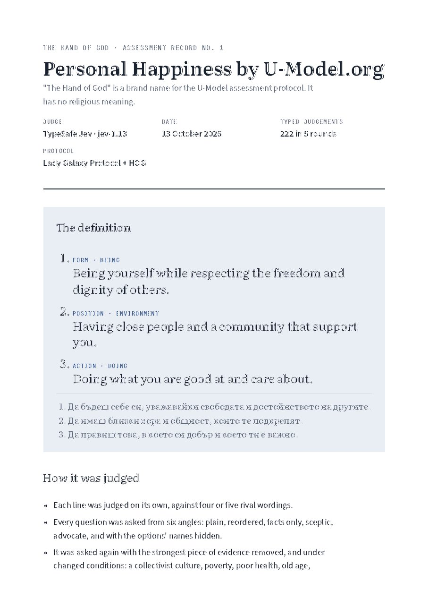

# THE HAND OF GOD · Assessment Record No. 1 — Personal Happiness

*"The Hand of God" is a brand name for the U-Model assessment protocol (appendix HOG). It has no religious meaning.*

This folder is the complete record of one experiment: an AI judge was used, step by step, to define one basic human category, **personal happiness**, and every judgement was timestamped. All packets, raw answers and results are here, so anyone can check how each line was chosen.

## The definition

> **Personal Happiness by U-Model.org**
> 1. Being yourself while respecting the freedom and dignity of others.
> 2. Having close people and a community that support you.
> 3. Doing what you are good at and care about.

> **Личното щастие според U-Model.org**
> 1. Да бъдеш себе си, уважавайки свободата и достойнството на другите.
> 2. Да имаш близки хора и общност, които те подкрепят.
> 3. Да правиш това, в което си добър и което ти е важно.



## Judge and protocol

- **Judge:** TypeSafe Jev, model `jev-1.13.0`. It is a typed judge: it returns probabilities for defined options (Choice) and for claims (Noul), not prose.
- **Protocol:** Lady Galaxy Protocol + HOG. What can be computed is never asked; what is asked is never permission.
- **Date:** 13 October 2026, 09:09–09:21 UTC.
- **Judgements:** 222 typed calls in 5 rounds, all completed, none failed.

## How the definition was built

Each line was judged separately, as one pillar of the U-Model triad: Form (being), Position (environment), Action (doing). In every round each question was asked from six angles:

| Angle | What changes |
|---|---|
| base | nothing; the canonical packet |
| order | counter-evidence first, evidence and options reshuffled |
| facts | the proposer's mechanism is hidden |
| skeptic | the burden of proof is on acting |
| advocate | the burden of proof is on waiting |
| blind | option names are replaced by neutral labels |

Each packet was then asked again with its strongest evidence removed, or with one assumption changed: a collectivist culture, poverty, poor health, old age, social isolation.

| Round | Calls | Question | Outcome |
|---|---:|---|---|
| 1 | 120 | Original three lines; 4 lenses × 5 scenarios × 6 angles; necessity, completeness and non-compensation claims | Lines 1 and 2 should be reworded; line 3 kept as a lean; completeness and non-compensation **not supported** |
| 2 | 36 | Five new wordings per line | Line 2 "close people and a community" **0.79, robust**; line 3 "what you are good at and care about" **0.83, robust** |
| 3 | 18 | Line 1, five wordings | "Accepting yourself and living by your own values" leads, 0.47 |
| 4 | 24 | Line 1: does it need explicit regard for others? | Descriptively **no**: the plain wording wins 0.89; the claim scores 0.22 vs 0.23 |
| 5 | 24 | Line 1 under a **normative** objective: accurate *and* acceptable for universal endorsement | "Being yourself while respecting the freedom and dignity of others" first, **0.46, prevailing**; "without harming others" 0.03 |

### Why line 1 carries a moral clause

Judged for description alone, Jev preferred "Accepting yourself and living by your own values" (0.89). The author changed the objective on purpose: a definition of happiness that claims universal recognition must not advertise happiness for people who harm others. That change is recorded as the author's decision, not as Jev's finding. Under the new objective, Jev put respect for the freedom and dignity of others first, in line with Article 1 of the Universal Declaration of Human Rights.

## What this record does not show

| Claim | Jev · claim / opposite | Reading |
|---|---|---|
| The three lines cover the main causes of happiness | 0.28 / 0.37 | not enough evidence |
| Lacking any one line rules out lasting happiness | 0.30 / 0.38 | not enough evidence |

- The three lines are offered as **the three supports** of happiness, not as a proven complete or multiplicative formula.
- The research facts in the packets (self-determination theory, the Harvard Study of Adult Development, PERMA, flow, strengths and kindness studies, UDHR) were summarised from the literature and were not re-checked against the sources for this record.
- 222 answers from one model are not 222 independent observations. Agreement across angles is descriptive, not a p-value or a calibrated probability.
- Jev's probabilities are not yet calibrated against recorded outcomes.

## What it demonstrates

This record shows one procedure applied to one category: candidate wordings, six angles, evidence removal, changed conditions, a separate normative round, and a timestamp on every judgement. The same procedure can be repeated iteratively for other basic human categories, such as love, freedom, justice, trust or success. Each needs its own evidence and its own record; nothing here is a result for them.

## Files

| Path | Content |
|---|---|
| `HOG_Record_01_Personal_Happiness.pdf` | the record (3 pages, A4) |
| `HOG_Record_01_Personal_Happiness.pdf.ots` | OpenTimestamps proof of the PDF |
| `HOG_Record_01_Personal_Happiness.html` | the same record as a web page |
| `pages/` | page images of the PDF |
| `experiment/packets/` | the exact question packets of each round: evidence, counter-evidence, options, scenarios |
| `experiment/answers/` | raw typed answers, one line per call, with `call_id`, model and packet hash |
| `experiment/results/` | per-round panel summaries: medians, consensus, margin, reading |

## Timestamps

All 222 judgements were stamped with OpenTimestamps on 13 October 2026 between 09:10 and 09:21 UTC, anchored in Bitcoin. Only hashes left the machine. Batches: `20261013T091028Z-282a45`, `20261013T091508Z-7f8566`, `20261013T091642Z-c88a84`, `20261013T091907Z-abcb20`, `20261013T092107Z-96dc70`. Per-judgement proofs are held with the private journal and are available for verification on request. The PDF's own proof is in this folder:

```
ots verify HOG_Record_01_Personal_Happiness.pdf.ots
```

PDF SHA-256: `3408c45ff48ee3aa15bea3f1b5094fab519ed475d4c025788c6c70d7c5e1dd21`

## Links

- HOG appendix (PDF, OSF): https://osf.io/74xgr/files/wqhvd
- HOG folder: https://github.com/UniversalModel/core/tree/main/HOG

Petar Nikolov · independent researcher, Sofia · ORCID 0009-0001-8669-2276
